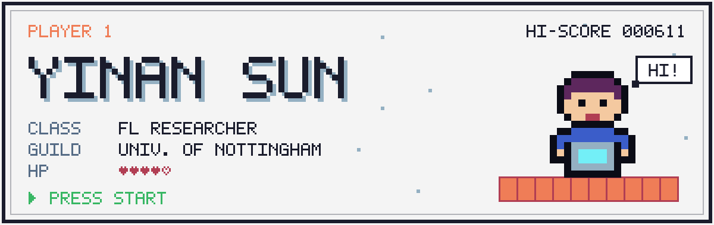
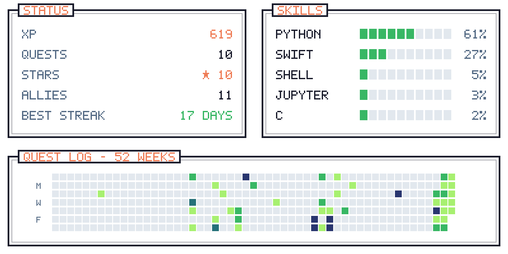

<picture>
  <source media="(prefers-color-scheme: dark)" srcset="./assets/header-dark.svg" />
  
</picture>

▶ <a href="https://isaac-sun.github.io"><b>WEBSITE</b></a> &nbsp;&nbsp; ▶ <a href="https://www.linkedin.com/in/isaac-sun/"><b>LINKEDIN</b></a> &nbsp;&nbsp; ▶ <a href="mailto:scyys25@nottingham.edu.cn"><b>EMAIL</b></a>

### ▶ STAGE SELECT

| Stage | Quest | Loot |
| :-: | :-- | :-- |
| **1-1** | **[fedfree](https://github.com/isaac-sun/fedfree)** Unmask free-riders hiding inside a federation, using per-class Shapley values. | `Python` `PyTorch` |
| **1-2** | **[chest-xray-federated-learning](https://github.com/isaac-sun/chest-xray-federated-learning)** Train a pneumonia detector two ways — centralized and federated — and compare the loot. | `Python` `PyTorch` |
| **1-3** | **[omp-api-manager](https://github.com/isaac-sun/omp-api-manager)** Tame a whole fleet of AI providers from one local-first macOS app. | `Swift` `SwiftUI` |
| **1-4** | **[BookVault](https://github.com/isaac-sun/BookVault)** Keep a bookstore's inventory in order from the terminal, in plain C. | `C` `CLI` |

Bonus levels → <a href="https://github.com/isaac-sun?tab=repositories">all repositories</a> · <a href="https://github.com/isaac-sun/cs-ai-learning-notes">cs-ai-learning-notes</a>

### ▶ PLAYER STATS

<picture>
  <source media="(prefers-color-scheme: dark)" srcset="./assets/status-dark.svg" />
  
</picture>

### ▶ INVENTORY

`Python` `PyTorch` `Jupyter` `LaTeX` `C` `Swift` `TypeScript` `SQL` `Git` `Docker` `Linux`

### ▶ CURRENT QUEST

> Studying CS + AI at the University of Nottingham and running new federated-learning experiments. 
> **Party wanted:** open to research collaboration & internships — [send a message](mailto:scyys25@nottingham.edu.cn).
